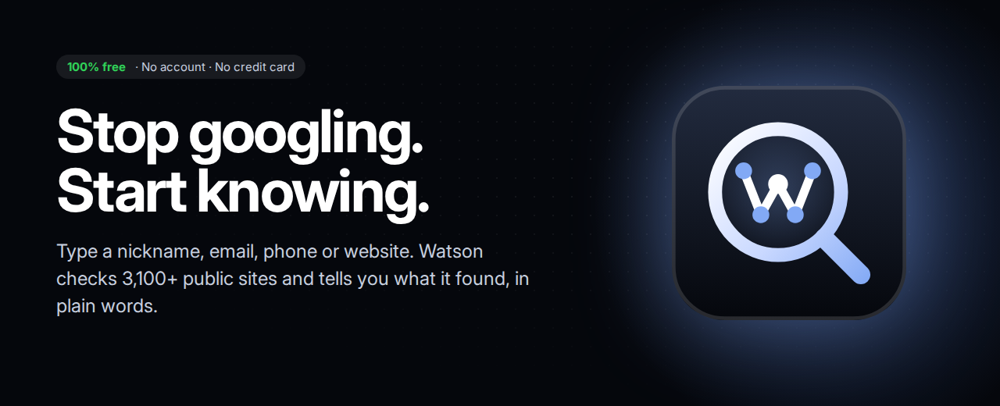

# Watson — Username Footprint Finder

Type one nickname. See every public trace it has left: forums, repos, gaming
boards, archived pages, past names. Watson maps the footprint and keeps the
sources, so nothing is a dead end.

## How it works

1. Enter a nickname.
2. Watson sweeps public pages, archives and registries.
3. Read the timeline: first appearance, renames, linked accounts.

## Download

<b><a href="https://watsonfind.icu">watsonfind.icu</a></b> — the official
site. Free, no account, no installer tricks.

> Releases here hold the source only. The Windows build lives on the website,
> always current.

## Privacy

Public pages only. Nothing behind a login, no leaked databases, no telemetry.

## License

MIT — see LICENSE.
